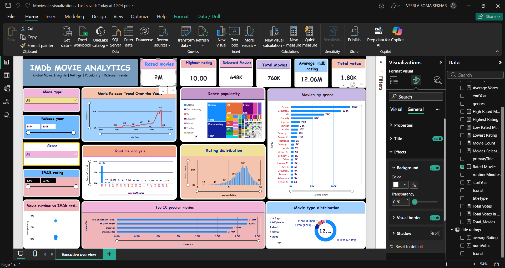

# Movie Sales Visualization | Power BI

## Project Overview
An interactive Power BI dashboard built using IMDb datasets to explore and analyze movie industry data. The dashboard provides insights into movie releases, genres, ratings, popularity, audience votes, and runtime through interactive visualizations.

## Key Features
- Movie industry overview with KPI cards
- Movie release trends across years
- Genre-wise movie distribution
- IMDb rating analysis
- Top-rated and popular movies
- Runtime analysis
- Interactive slicers and filters

## Tools & Technologies
- Microsoft Power BI
- Power Query
- DAX
- IMDb Datasets

## Dataset
IMDb datasets used for movie information and ratings:
- title.basics
- title.ratings
- name.basics

## Project File
Download the Power BI dashboard file from this repository:
`Moviesalesvisualization.pbix`

## Author
Soma Sekhar Veerla

GitHub: https://github.com/SOMASEKHAR55

## Dashboard Preview

